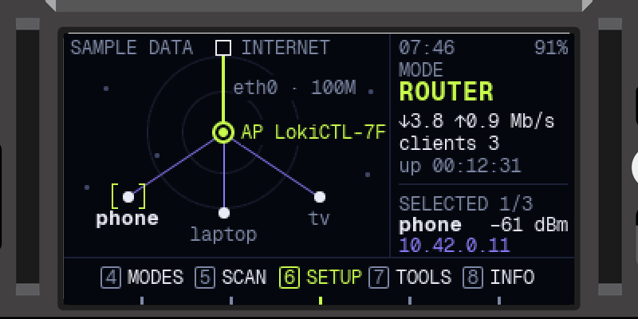
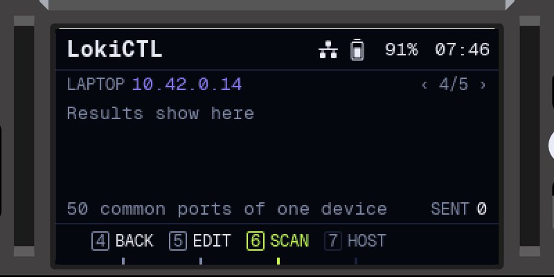
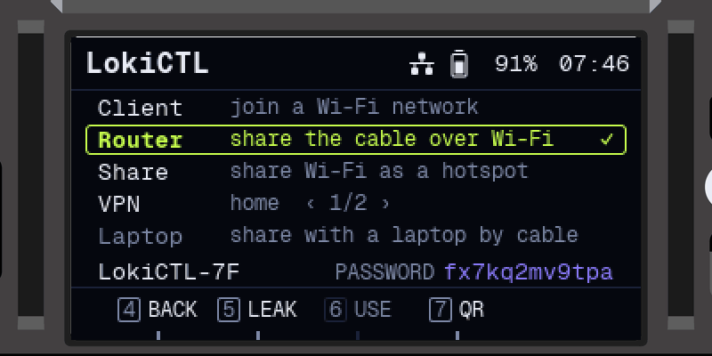
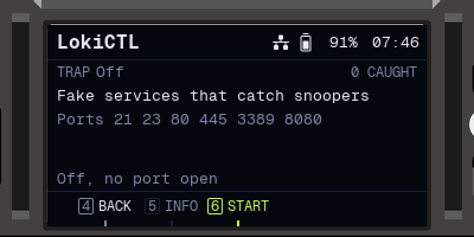
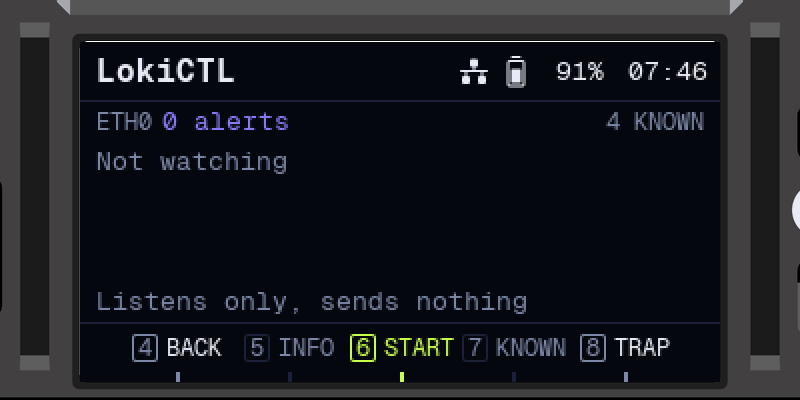
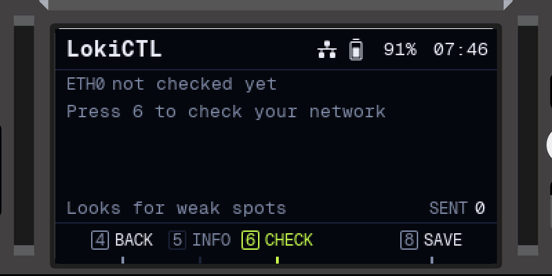
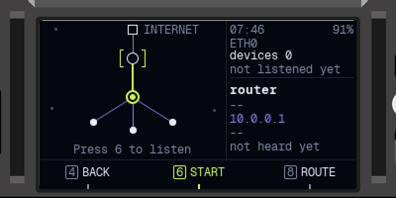
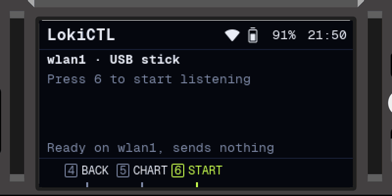
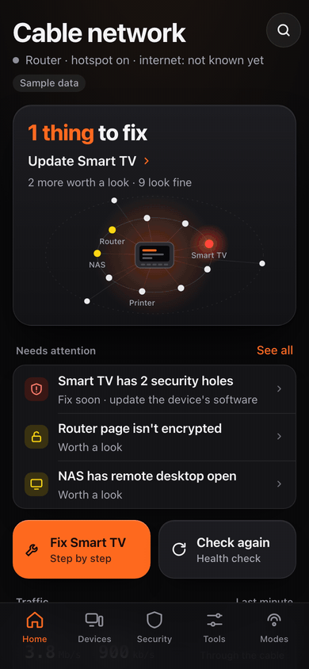
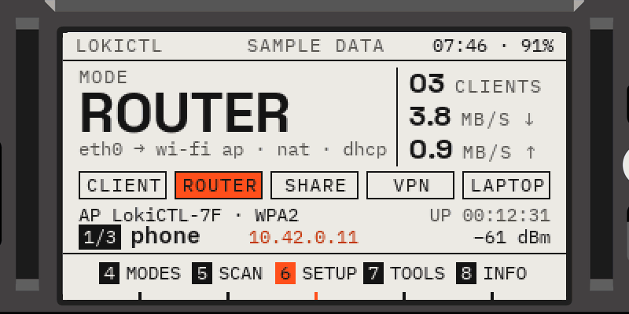

<!--
SPDX-FileCopyrightText: 2026 LokiCTL contributors
SPDX-License-Identifier: MIT
-->

# LokiCTL

A pocket network multitool for the M5Stack CardputerZero. I couldn't wait
for the Flipper One, so I built my own small network tool in the meantime.



LokiCTL shows what your network is doing at a glance. It can turn the
CardputerZero into a small router or hotspot, send traffic through a
WireGuard VPN, find the devices on your network and run the usual network
tools: ping, DNS lookup, traceroute, a Wi-Fi scan, a port scan and speed
tests to the internet and inside your own network. Apart from the Wi-Fi
survey, which needs a USB Wi-Fi stick, everything runs on the built-in
Wi-Fi and the Ethernet port, so you don't need extra hardware.

It has three looks (Instrument, Constellation and Terminal) and a command
bar if you'd rather type than press keys.

## What it can do

These clips come from the desktop simulator with made-up data, so no real
network is in them. To install LokiCTL, skip to [Install](#install).

### Find known security holes on your devices



The port scan asks what software runs on each open port of a device and
checks it against a built-in list of known security holes. Each hole shows
how serious it is, whether attackers use it right now and how to fix it,
with a QR code that opens its page on your phone. Nothing is sent until you
press `6` twice.

### Put every device on your hotspot behind a VPN



Router turns the Cardputer into a Wi-Fi hotspot that shares a network
cable's internet. Turn on VPN as well, using the WireGuard file from your
VPN provider, and devices on the hotspot can only go out through the VPN.
A kill switch cuts them off if it drops, and the leak test checks that
nothing gets around it.

### Set a trap and see who pokes around



The trap is a honeypot: the Cardputer pretends to offer remote login, file
sharing, web pages and a few other services nobody has a reason to use.
Anyone who connects shows up at once with what they tried, a strong sign
that device is looking for weak spots. It never runs anything it is sent.

### Know when a new device or a fake router shows up



Once you turn it on, Watch listens to your network while LokiCTL is open
and sends nothing. A short message pops up on any page when a new device
joins, when someone scans the Cardputer or when someone may be pretending
to be your router.

### Check your own network for weak spots in one go



The health check finds your devices, tries the common ports on up to 32 of
them and looks at your Wi-Fi's security, the cable link and nearby networks
that copy your Wi-Fi's name. What it finds is listed worst first, and each
line opens to say what it means and how to fix it.

### See the devices on your network on a map



Discover listens for five minutes to what your devices send anyway and
sends nothing itself. Each device shows up with its name, address and
sometimes what it is, like a printer or a media player. The map draws them
around your router and shows the details of the one you pick.

### Spot look-alike networks and Wi-Fi attacks nearby



With a USB Wi-Fi stick plugged in (the built-in Wi-Fi can't do this), the
survey listens to the Wi-Fi around you for five minutes and sends nothing.
It flags someone knocking devices off Wi-Fi (a kick-off attack), a network
that copies your Wi-Fi's name with weaker security, and busy channels.

### Use it from your phone or computer



Turn on Remote view in Settings, open the address it shows in a browser on
the same network and type the six-digit code. The dashboard says if your
network is OK and what to fix first, and each device's page lists its known
security holes and how to fix them. There's nothing to install, but the
connection isn't encrypted, so only use it on networks you trust.

### Pick the look you like



Instrument has warm paper colours and big numbers, Constellation is dark
blue with a lime accent, and Terminal is black and amber. Pick one in
Settings or type `theme terminal` in the command bar.

## Install

From the store: find LokiCTL in the CardputerZero app store at
[cardputer.cc](https://cardputer.cc) and install it. It shows up on HOME
like any other app.

From a `.deb` file: copy the package to the device and install it with apt.

```sh
sudo apt install ./lokictl_<version>-<revision>_arm64.deb
```

apt also installs what LokiCTL needs: `dnsmasq-base` and `nftables` for the
hotspot, `iw` and `libcap2-bin` for the helpers, and `libcurl4t64` with
`ca-certificates` for the speed test, and `iperf3` for the LAN speed test.
If apt asks whether to start iperf3 as a daemon, keep the default, No:
LokiCTL only runs it while you use the LAN page. `sudo apt remove lokictl`
removes the app, its polkit rule and its helpers. Your settings in
`~/.config/lokictl/` stay.

The network features need your user to be in the `netdev` group. The
standard user on the CardputerZero image already is.

## Keys

| Key | What it does |
|---|---|
| `4` to `8` | The soft keys. The bar at the bottom of the screen shows what each one does on the current page. |
| `F` `X` `Z` `C` | Up, down, left and right. You don't need to hold fn. |
| `Enter` | Opens, runs or uses the highlighted item. |
| `ESC` | Goes back one page. It also cancels typing and closes the help panel or the command bar. |
| hold `ESC` | On Home it quits LokiCTL. On other pages the launcher closes the app after about 3 seconds. |
| `:` (sym+S) | Opens the [command bar](docs/guide.md#command-bar). |
| `TAB` | Completes a word in the command bar. |
| fn+H | Shows the keys of the page you're on. |
| fn+J | Saves a screenshot to `~/Pictures/Screenshots`. |

After a minute without a key press the screen dims, and on battery it
turns off a few minutes later. The first key press only wakes it up. You
can switch dimming off in Settings. LokiCTL also warns you when the
battery gets down to 15 % and again at 5 %.

## Full guide

The [guide](docs/guide.md) explains everything in detail:

- [Pages](docs/guide.md#pages): what each page shows and its keys
- [Modes](docs/guide.md#modes): Client, Router, Share, Laptop link and the
  VPN
- [Command bar](docs/guide.md#command-bar): the commands you can type
- [Themes](docs/guide.md#themes): the three looks
- [Permissions](docs/guide.md#permissions): what LokiCTL may change on the
  device and why
- [Words used in LokiCTL](docs/guide.md#words-used-in-lokictl): plain
  explanations of words like hole, CVE and VPN
- [Data use](docs/guide.md#data-use): how much data the tests move
- [Limits](docs/guide.md#limits): what the hardware can't do
- [Building](docs/guide.md#building): building it yourself

## Legal

Only scan, probe, capture or survey networks you own or are allowed to test.
Listening sends nothing, but a probe and a port scan do, and doing that on
someone else's network can break their rules or the law. Saved captures
and reports contain what devices on the network said about themselves, so
treat them as private. Your WireGuard file never leaves the device.

LokiCTL is an independent project. It is not affiliated with or endorsed
by M5Stack or Flipper Devices.

## Documentation

- [docs/guide.md](docs/guide.md): the full guide to every page, mode
  and command
- [docs/development.md](docs/development.md): building, snapshots and
  testing on a device
- [docs/permissions.md](docs/permissions.md): the polkit rule, the helpers
  and the files LokiCTL writes
- [docs/navigation.md](docs/navigation.md): every key on every page, and
  the command bar in detail
- [docs/home.md](docs/home.md): the home page in each theme
- [docs/themes.md](docs/themes.md): colours, fonts and spacing of the
  themes
- [docs/data.md](docs/data.md): where the values come from and how the
  tools and modes work
- [docs/checks.md](docs/checks.md): the check for known security holes
  and old versions, and how its list is made
- [docs/remote.md](docs/remote.md): Remote view and how it is kept private
- [docs/fonts.md](docs/fonts.md): the bundled fonts

## Support

LokiCTL is free and stays free. If it is useful to you, you can buy me a
coffee on [Ko-fi](https://ko-fi.com/weeknds). It helps pay for test gear,
so new features get tried on real hardware. Bug reports and ideas are just
as welcome: open an issue on GitHub.

## License and credits

LokiCTL is released under the MIT license, see [LICENSE](LICENSE).

- It started from M5Stack's
  [CardputerZero application template](https://github.com/CardputerZero/Template)
  (MIT). Files that came from it keep their original copyright headers.
- [LVGL](https://lvgl.io) (MIT) draws the screens. Its copy of Project
  Nayuki's [QR Code generator](https://www.nayuki.io/page/qr-code-generator-library)
  (MIT) makes the hotspot's join code. Other parts it brings are compiled
  in too: Matthew Conte's TLSF allocator (BSD-3-Clause), Marco Paland's
  printf (MIT), the Montserrat fonts (SIL OFL 1.1) with Font Awesome Free
  symbols and ChaN's TJpgDec; their notices are in
  [docs/third-party/lvgl-bundled.txt](docs/third-party/lvgl-bundled.txt).
- The list of known security holes is made from NIST's National
  Vulnerability Database and CISA's Known Exploited Vulnerabilities
  catalog (CC0 1.0). This product uses the NVD API but is not endorsed or
  certified by the NVD. Details are in
  [docs/third-party/vulnerability-data.md](docs/third-party/vulnerability-data.md).
- The web dashboard uses [Preact](https://preactjs.com) (MIT), copied
  unchanged into `assets/web/`; its notice is in
  [docs/third-party/preact-license.txt](docs/third-party/preact-license.txt).
- Fonts: Space Grotesk, Inter, IBM Plex Mono, Geist Mono and JetBrains
  Mono, under the SIL Open Font License 1.1. Icons: Phosphor Icons (MIT).
  The licenses are in [assets/fonts/](assets/fonts/LICENSE.txt).
