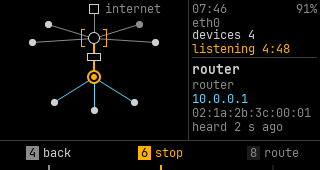
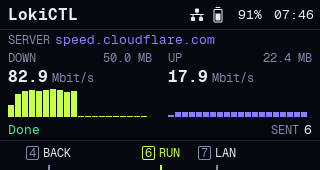

<!--
SPDX-FileCopyrightText: 2026 LokiCTL contributors
SPDX-License-Identifier: MIT
-->

# LokiCTL

A pocket network multitool for the M5Stack CardputerZero.


LokiCTL shows what your network is doing at a glance. It can turn the
CardputerZero into a small router or hotspot, send traffic through a
WireGuard VPN, find the devices on your network and run the usual network
tools: ping, DNS lookup, traceroute, a Wi-Fi scan, a port scan and a speed
test. Everything runs on the built-in Wi-Fi and the Ethernet port, so you
don't need extra hardware.

It has three looks (Instrument, Constellation and Terminal) and a command
bar if you'd rather type than press keys.

## Install

From the store: find LokiCTL in the CardputerZero app store at
[cardputer.cc](https://cardputer.cc) and install it. It shows up on HOME
like any other app.

From a `.deb` file: copy the package to the device and install it with apt.

```sh
sudo apt install ./lokictl_<version>-<revision>_arm64.deb
```

apt also installs what LokiCTL needs: `dnsmasq-base` and `nftables` for the
hotspot, `iw` and `libcap2-bin` for the helpers, and `libcurl4t64` with
`ca-certificates` for the speed test. `sudo apt remove lokictl` removes the
app, its polkit rule and its helpers. Your settings in `~/.config/lokictl/`
stay.

The network features need your user to be in the `netdev` group. The
standard user on the CardputerZero image already is.

## Keys

| Key | What it does |
|---|---|
| `4` to `8` | The soft keys. The bar at the bottom of the screen shows what each one does on the current page. |
| `F` `X` `Z` `C` | Up, down, left and right. You don't need to hold fn. |
| `Enter` | Opens, runs or uses the highlighted item. |
| `ESC` | Goes back one page. It also cancels typing and closes the help panel or the command bar. |
| hold `ESC` | On Home it quits LokiCTL. On other pages the launcher closes the app after about 3 seconds. |
| `:` (sym+S) | Opens the [command bar](#command-bar). |
| `TAB` | Completes a word in the command bar. |
| fn+H | Shows the keys of the page you're on. |
| fn+J | Saves a screenshot to `~/Pictures/Screenshots`. |

After a minute without a key press the screen dims, and on battery it
turns off a few minutes later. The first key press only wakes it up. You
can switch dimming off in Settings. LokiCTL also warns you when the
battery gets down to 15 % and again at 5 %.

## Pages

### Home

The page LokiCTL starts on. It shows the mode, how you're connected (Wi-Fi,
cable or not at all), your address, the router, the signal or link speed,
live download and upload speed with a small graph, the time and the
battery. While the hotspot runs it also shows the devices on it: pick one
with F/X/Z/C and press Enter to open it on the Devices page.

Each theme draws Home its own way: a big gauge in Instrument, a small
network map in Constellation and boxed panes in Terminal. The soft keys are
`4` MODES, `5` SCAN (Discover), `6` SETUP (Settings), `7` TOOLS and `8` INFO
(Status).

### Modes, Hotspot and Devices

Modes (`4` on Home) switches between Client, Router, Share and VPN. See
[Modes](#modes) for what each one does.

Hotspot (`7` on Modes) shows a QR code that a phone camera can scan to join
the hotspot, next to its name, password, channel and how long it has run.
`5` renames the hotspot and `6`, pressed twice, makes a new random password.
If the hotspot is running, it restarts with the new name or password and
everyone has to join again.

Devices (`Enter` on Home) lists the phones and laptops on the hotspot with
their name, address, traffic, hardware address and when they joined. `8`
blocks the highlighted device: it stays connected but gets no address, no
internet and no answer from the Cardputer. Press `8` again to allow it.
Blocking goes by hardware address, so a phone that picks a new random one
for each network shows up as a new device.

### Status

`8` on Home. Everything the home page has no room for: each network port
with its addresses, signal and speed, the VPN, any USB Wi-Fi adapter, the
DNS servers, the battery, the processor temperature, free memory and
uptime. F/X scroll, Z/C jump between sections.

### Settings

`6` on Home. Pick the theme, switch screen dimming on or off, turn on
[Remote view](#remote-view), and choose whether the network mode keeps
running after you quit LokiCTL ("Keep mode after quitting", off by
default).

### Tools

`7` on Home. Pick a tool with F/X and open it with `Enter` or `6`. On
Ping, DNS, Trace and Ports, Z/C steps through a few ready-made targets
(your router or `9.9.9.9`, for example) and `5` lets you type your own.
`Enter` or `6` starts and stops a run. Only one tool runs at a time, and a
counter at the bottom shows how many packets LokiCTL has sent.

- Ping sends 10 echoes and shows the times and the loss.
- DNS looks up a name and shows its addresses and the server that answered.
- Trace shows the route to a host hop by hop, with times and names, up to
  20 hops.
- Wi-Fi lists the networks the built-in Wi-Fi can hear, with signal,
  channel and security. It can't scan while the hotspot runs.
- Ports tries 50 common TCP ports on one device, 10 a second. It only takes
  private addresses (like `192.168.x.x`) on a network the Cardputer is on,
  and it sends nothing until you press `6` a second time.
- Speed downloads and then uploads for 10 seconds each, or 50 MB each,
  whichever comes first. It uses Cloudflare's speed test over HTTPS. You
  can use another server with a `speed_test_server=` line in the
  `[application]` section of `~/.config/lokictl/lokictl.conf`.

### Discover and Map

Discover (`5` on Home) finds the devices on the network the Cardputer is
on, in up to three steps:

1. Listen (`6`): for five minutes LokiCTL listens to the traffic devices
   send anyway (ARP, DHCP, mDNS and SSDP) and sends nothing itself. You get
   each device's hardware address, IP address, name and sometimes what it
   is (a printer, a Google Cast device, a media player).
2. `8` shows your address and the range a probe would cover. Nothing is
   sent yet.
3. Probe (`8` again): asks every address of your local network (private
   networks only, at most 254 addresses, 20 a second), so quiet devices show
   up too, then asks for their names and kinds.

`7` saves the listen run as a PCAP file in
`~/.local/share/lokictl/captures/` that you can open in Wireshark.

Map (`5` on Discover) draws the same devices around your router, with the
internet above and the hotspot's devices below. Move with F/X/Z/C, and the
panel on the right shows the selected device. `6` starts a listen run from
here too.

### Remote view

Remote view shows the Cardputer's screen in a web browser on another
computer on the same network, and you can press its keys from there. Turn
it on in Settings. The screen then shows an address and a six-digit code
that you type into the browser. It's off every time LokiCTL starts, a
`REMOTE` tag shows while someone is watching, and `7` on its row also lets
devices on LokiCTL's own hotspot in. It uses plain HTTP, so only use it on
networks you trust. More in [docs/remote.md](docs/remote.md).

## Modes

Open Modes with `4` on Home, pick a row and press `Enter` or `6`. A tick
marks what's on.

- Client is the normal state: the Cardputer joins a Wi-Fi network like
  a phone does. LokiCTL changes nothing.
- Router shares a wired internet connection through a Wi-Fi hotspot of
  its own. Plug a cable into the Ethernet port first. The built-in Wi-Fi
  leaves your Wi-Fi network and runs the hotspot instead, handing out
  addresses and sharing the cable's connection. The hotspot is called
  `LokiCTL-` plus four characters, and LokiCTL makes a random password the
  first time.
- Share stays on the Wi-Fi network the Cardputer has joined and runs
  the same hotspot next to it, so devices on the hotspot get the
  Cardputer's internet (the cable if one is plugged in, otherwise the
  Wi-Fi). It adds a second interface, `lokiap0`, on the same chip, so the
  hotspot has to use your network's channel. Your Wi-Fi drops for a few
  seconds when the hotspot starts or stops, usually 2 to 3, and up to about
  15 after a new name or password.
- VPN sends the Cardputer's traffic through a WireGuard tunnel
  (`lokiwg0`). Copy a WireGuard client file (the `.conf` that VPN providers
  and routers hand out) into `~/.config/lokictl/wireguard/`, for example
  with `scp`. With more than one file, Z/C on the VPN row picks one. `6`
  turns the tunnel on and off. Lines like `PostUp` in the file are ignored,
  so nothing in it ever runs.
- VPN gateway is VPN together with Router or Share, switched on in
  either order. Devices on the hotspot then go out only through the
  tunnel, DNS included. A kill switch in LokiCTL's own firewall table
  blocks them completely if the tunnel drops, instead of letting them out
  around it, and the page says `VPN down: hotspot devices blocked`. `6` on
  the VPN row reconnects, and `8` turns the VPN off and lets them out
  directly again.

Router and Share can't run at the same time. Go back to Client first.

When you quit LokiCTL, it puts things back: the hotspot, the tunnel and the
firewall rules go away and the Cardputer rejoins the Wi-Fi it was on. To
keep the mode running after you quit, switch on "Keep mode after quitting"
in Settings, and the next start picks it up again. A restart of the device
always ends in Client, because LokiCTL keeps its hotspot and VPN profiles
in memory only.

## Command bar

Press `:` (sym+S) on any page to open a one-line command bar at the bottom
of the screen. Type a command and press `Enter`. `TAB` completes commands
and names, up and down (fn+F and fn+X) bring back the last 8 commands, and
`ESC` closes the bar. Case doesn't matter.

| Command | What it does |
|---|---|
| `help` | Lists the commands. |
| `home`, `map`, `tools`, `discover`, `wifi`, `status`, `settings` | Opens that page. |
| `theme <name>` | Switches to `instrument`, `constellation` or `terminal`. |
| `mode <name>` | Switches to `client`, `router`, `share` or `vpn`. |
| `ping [target]` | Pings a host, or the target that's selected on the Ping page. |
| `dns [name]` | Looks up a name. |
| `trace [target]` | Traces the route to a host. |
| `ports [address]` | Opens the port scan for an address. Press `6` to start it. |
| `scan` | Starts a listen run on the Discover page. This is not a Wi-Fi scan; `wifi` opens that. |
| `probe` | Opens the probe step on Discover. Press `8` to start it. |
| `speed` | Starts a speed test right away, without asking. |

For `ping`, `trace` and `ports` you can type `router` or `this` instead of
an address. `scan`, `probe` and `speed` need a network, and a tool command
does nothing while another tool runs.

## Themes

Switch the theme in Settings or with `theme <name>`. Your choice is saved.

- Instrument: warm paper colours, thin ink lines and big numbers.
- Constellation (the default): dark blue with a lime accent.
- Terminal: black with grey boxes and an amber accent.





## Permissions

LokiCTL runs as your normal user. Nothing in it runs as root and nothing is
setuid. The package adds three things so the network features work:

- A polkit rule. Apps started from the launcher may not change
  NetworkManager's settings on their own, so this rule lets members of the
  `netdev` group control the network, change system connections and start
  a WPA-protected hotspot. polkit can't tell programs apart, so every
  program a `netdev` member runs gets these rights, not only LokiCTL.
- `lokictl-helper`, a tiny program with one capability, `CAP_NET_ADMIN`.
  It runs eight fixed commands and only touches LokiCTL's own firewall
  table (`inet lokictl`, used for blocking and the kill switch) and Share's
  extra interface, `lokiap0`.
- `lokictl-capture`, a tiny program with one capability, `CAP_NET_RAW`.
  It only hears ARP, DHCP, mDNS and SSDP, it can't send anything, and it
  stops when the listen run ends.

Only root and the `netdev` group can run the two helpers. Removing the
package removes all three. [docs/permissions.md](docs/permissions.md) has
the details and lists every file LokiCTL writes.

## Data use

- A speed test moves up to about 100 MB, so be careful on a metered
  connection. It talks to Cloudflare unless you set another server.
- Apart from the tools you start yourself, LokiCTL sends nothing to the
  internet. There are no accounts and no analytics.
- Settings, the hotspot password and saved captures stay on the device,
  and only your user can read them.

## Limits

- The built-in Wi-Fi is 2.4 GHz only, so the hotspot and the Wi-Fi list are
  2.4 GHz only too.
- The Ethernet port runs at 10/100 Mbit/s, and it only works with the USB
  switch on the left side set to Host.
- The hotspot hands out IPv4 addresses only.
- While the hotspot runs, the Devices page can't show each device's
  signal.
- A USB Wi-Fi adapter isn't needed and isn't used. If you plug one in,
  LokiCTL tells you and lists it on the Status page, but leaves it alone.
- Typing gives lowercase letters, digits, `.` and space for now.

## Legal

Only scan, probe or capture networks you own or are allowed to test.
Listening sends nothing, but a probe and a port scan do, and doing that on
someone else's network can break their rules or the law. Saved captures
contain what devices on the network said about themselves, so treat them
as private. Your WireGuard file never leaves the device.

LokiCTL is an independent project. It is not affiliated with or endorsed
by M5Stack or Flipper Devices.

## Building

The simulator runs on a Mac:

```sh
brew install cmake ninja libpng jpeg fmt sdl2 freetype
cmake --preset darwin-arm64
cmake --build --preset darwin-arm64-dbg
./build/darwin-arm64/Debug/lokictl
```

In the simulator, mode switches and network tools only pretend, so you can
try every page without touching your network.

The device package is built in a Debian arm64 container, so you need a
running Docker engine (on a Mac, for example `colima start`):

```sh
./scripts/build-deb.sh
```

It writes `dist/lokictl_<version>-<revision>_arm64.deb`.

The program itself takes a few options:

| Option | What it does |
|---|---|
| `--theme <name>` | Starts in a theme for this run only. |
| `--data <name>` | Picks where the values come from: `live`, `demo`, `sample`, `wifi`, `cable`, `offline` or `tour`. |
| `--snapshot <file.png>` | Draws one page into a 320x170 PNG without a window. |
| `--print-data` | Prints the current values as `name=value` lines. |
| `--list-pages` | Lists the page names for `--snapshot --page`. |
| `--help` | Shows every option. |

[docs/development.md](docs/development.md) covers the rest: snapshot
options, the device test kit (`scripts/device.sh`), building on Linux and
the project layout.

## Documentation

- [docs/development.md](docs/development.md): building, snapshots and
  testing on a device
- [docs/permissions.md](docs/permissions.md): the polkit rule, the helpers
  and the files LokiCTL writes
- [docs/navigation.md](docs/navigation.md): every key on every page, and
  the command bar in detail
- [docs/home.md](docs/home.md): the home page in each theme
- [docs/themes.md](docs/themes.md): colours, fonts and spacing of the
  themes
- [docs/data.md](docs/data.md): where the values come from and how the
  tools and modes work
- [docs/remote.md](docs/remote.md): Remote view and how it is kept private
- [docs/fonts.md](docs/fonts.md): the bundled fonts

## License and credits

LokiCTL is released under the MIT license, see [LICENSE](LICENSE).

- It started from M5Stack's
  [CardputerZero application template](https://github.com/CardputerZero/Template)
  (MIT). Files that came from it keep their original copyright headers.
- [LVGL](https://lvgl.io) (MIT) draws the screens. Its copy of Project
  Nayuki's [QR Code generator](https://www.nayuki.io/page/qr-code-generator-library)
  (MIT) makes the hotspot's join code.
- Fonts: Space Grotesk, Inter, IBM Plex Mono, Geist Mono and JetBrains
  Mono, under the SIL Open Font License 1.1. Icons: Phosphor Icons (MIT).
  The licenses are in [assets/fonts/](assets/fonts/LICENSE.txt).
