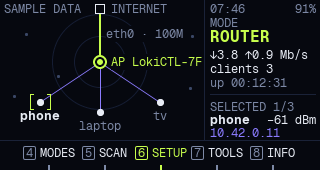
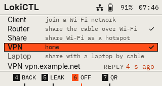

<!--
SPDX-FileCopyrightText: 2026 LokiCTL contributors
SPDX-License-Identifier: MIT
-->

# LokiCTL

A pocket network multitool for the M5Stack CardputerZero.



LokiCTL shows what your network is doing at a glance. It can turn the
CardputerZero into a small router or hotspot, send traffic through a
WireGuard VPN, find the devices on your network and run the usual network
tools: ping, DNS lookup, traceroute, a Wi-Fi scan, a port scan and speed
tests to the internet and inside your own network. Apart from the Wi-Fi
survey, which needs a USB Wi-Fi stick, everything runs on the built-in
Wi-Fi and the Ethernet port, so you don't need extra hardware.

It has three looks (Instrument, Constellation and Terminal) and a command
bar if you'd rather type than press keys.

## Install

From the store: find LokiCTL in the CardputerZero app store at
[cardputer.cc](https://cardputer.cc) and install it. It shows up on HOME
like any other app.

From a `.deb` file: copy the package to the device and install it with apt.

```sh
sudo apt install ./lokictl_<version>-<revision>_arm64.deb
```

apt also installs what LokiCTL needs: `dnsmasq-base` and `nftables` for the
hotspot, `iw` and `libcap2-bin` for the helpers, and `libcurl4t64` with
`ca-certificates` for the speed test, and `iperf3` for the LAN speed test.
If apt asks whether to start iperf3 as a daemon, keep the default, No:
LokiCTL only runs it while you use the LAN page. `sudo apt remove lokictl`
removes the app, its polkit rule and its helpers. Your settings in
`~/.config/lokictl/` stay.

The network features need your user to be in the `netdev` group. The
standard user on the CardputerZero image already is.

## Keys

| Key | What it does |
|---|---|
| `4` to `8` | The soft keys. The bar at the bottom of the screen shows what each one does on the current page. |
| `F` `X` `Z` `C` | Up, down, left and right. You don't need to hold fn. |
| `Enter` | Opens, runs or uses the highlighted item. |
| `ESC` | Goes back one page. It also cancels typing and closes the help panel or the command bar. |
| hold `ESC` | On Home it quits LokiCTL. On other pages the launcher closes the app after about 3 seconds. |
| `:` (sym+S) | Opens the [command bar](#command-bar). |
| `TAB` | Completes a word in the command bar. |
| fn+H | Shows the keys of the page you're on. |
| fn+J | Saves a screenshot to `~/Pictures/Screenshots`. |

After a minute without a key press the screen dims, and on battery it
turns off a few minutes later. The first key press only wakes it up. You
can switch dimming off in Settings. LokiCTL also warns you when the
battery gets down to 15 % and again at 5 %.

## Pages

### Home

The page LokiCTL starts on. It shows the mode, how you're connected (Wi-Fi,
cable or not at all), your address, the router, the signal or link speed,
live download and upload speed with a small graph, the time and the
battery. While the hotspot runs it also shows the devices on it: pick one
with F/X/Z/C and press Enter to open it on the Devices page.

Each theme draws Home its own way: a big gauge in Instrument, a small
network map in Constellation and boxed panes in Terminal. The soft keys are
`4` MODES, `5` SCAN (Discover), `6` SETUP (Settings), `7` TOOLS and `8` INFO
(Status).

### Modes, Hotspot and Devices

Modes (`4` on Home) switches between Client, Router, Share and VPN. See
[Modes](#modes) for what each one does.

Hotspot (`7` on Modes) shows a QR code that a phone camera can scan to join
the hotspot, next to its name, password, channel and how long it has run.
`5` renames the hotspot and `6`, pressed twice, makes a new random password.
If the hotspot is running, it restarts with the new name or password and
everyone has to join again.

Devices (`Enter` on Home) lists the phones and laptops on the hotspot with
their name, address, traffic, hardware address and when they joined. `8`
blocks the highlighted device: it stays connected but gets no address, no
internet and no answer from the Cardputer. Press `8` again to allow it.
Blocking goes by hardware address, so a phone that picks a new random one
for each network shows up as a new device.

`5` on Devices (or the command `talk`) shows what the highlighted device is
talking to: the names it looked up through the hotspot, newest first, with
how often (`example.com  x3`). `5`/`6` or Z/C go to the previous or next
device. It only works on LokiCTL's own hotspot, and only for lookups sent
to the hotspot itself; a device that uses encrypted or its own DNS shows
nothing. The names stay in memory and are gone when the hotspot stops. A
report you save (`8` or `R`) includes them.

### Status

`8` on Home. It starts with two short lines: how the cable link is doing
(`Cable: 100 Mbit, full, 0 drops`, or a warning such as `Cable: slow
link, check it`) and how long the battery lasts at the current use
(`Battery: about 3 h 20 min left`; it needs about a minute on battery to
tell). Then everything the home page has no room for: each network port
with its addresses, signal and speed, the VPN, any USB Wi-Fi adapter, the
DNS servers, the battery, the processor temperature, free memory,
uptime and the date of the built-in list of security holes. F/X scroll,
Z/C jump between sections.

### Settings

`6` on Home. Pick the theme, switch screen dimming on or off, turn on
[Remote view](#remote-view-and-the-web-dashboard), and choose whether
the network mode keeps running after you quit LokiCTL ("Keep mode after
quitting", off by default).

### Tools

`7` on Home. Pick a tool with F/X and open it with `Enter` or `6`. On
Ping, DNS, Trace and Ports, Z/C steps through a few ready-made targets
(your router or `9.9.9.9`, for example) and `5` lets you type your own.
`Enter` or `6` starts and stops a run (on Ports, `6` only, once a scan has
finished). Only one tool runs at a time, and a counter at the bottom shows
how many packets LokiCTL has sent.

- Ping sends 10 echoes and shows the times and the loss.
- DNS looks up a name and shows its addresses and the server that answered.
- Trace shows the route to a host hop by hop, with times and names, up to
  20 hops.
- Wi-Fi lists the networks the built-in Wi-Fi can hear, with signal,
  channel and security. It can't scan while the hotspot runs.
- Survey (`7` on Wi-Fi, or the command `survey`) needs an optional USB
  Wi-Fi stick (the built-in Wi-Fi can't do this). Press `6` and for five
  minutes the stick only listens, hopping over the 2.4 GHz channels your
  country allows. It lists what it hears in short lines: `Kick-off attack
  on ch 11` (someone is knocking devices off Wi-Fi), `Look-alike of
  HomeNet` (a network with your Wi-Fi's name and weaker security),
  `Channel 6: busy`, then every network, with hidden ones as `Hidden
  network`. `5` switches to a chart of how busy each channel is. It
  never sends anything. It listens through a second interface it adds
  on the stick, `lokimon0`, and leaves the stick's own one alone;
  `lokimon0` goes away when the survey ends, when you stop it or when
  LokiCTL quits. It only takes a
  stick NetworkManager leaves alone and that nothing else is using. If
  the page says `Stick is in use`, NetworkManager has it: put a file in
  `/etc/NetworkManager/conf.d/` with the lines `[keyfile]` and
  `unmanaged-devices=interface-name:wlan1` (your stick's name), then run
  `sudo nmcli general reload conf`.
- Ports tries 50 common TCP ports on one device, 10 a second. It only takes
  private addresses (like `192.168.x.x`) on a network the Cardputer is on,
  and it sends nothing until you press `6` a second time. Open ports are
  asked what they run: SSH, FTP, mail and Telnet servers by their
  greeting, web servers by one request for their name, a name server
  (port 53) by one question for its version. After a scan,
  `Enter` or `7` shows the device: its name and MAC address if Discover
  knows them, each open port in plain words ("remote login", "web page")
  with the software it named, and a short note under ports that are often
  a risk (Telnet sends passwords in plain text, for example).
- Ports also checks each version it read against a built-in list of
  known security holes and old versions, so you can see what needs an
  update. A port gets a short tag (see [Words used in
  LokiCTL](#words-used-in-lokictl)), the device view lists each hole, and
  `6` shows one at a time with what to do and a QR code that opens its
  page on your phone. It only compares version numbers, so a device that
  was fixed quietly can still show up. [docs/checks.md](docs/checks.md)
  explains it all.
- Speed downloads and then uploads for 10 seconds each, or 50 MB each,
  whichever comes first. It uses Cloudflare's speed test over HTTPS. You
  can use another server with a `speed_test_server=` line in the
  `[application]` section of `~/.config/lokictl/lokictl.conf`.
- LAN (`7` on Speed, or the command `lan`) measures the speed to another
  device on your own network with iperf3, 10 seconds each way. Pick the
  router or a device Discover found with `Z`/`C`, or type an address with
  `5`; that device needs an iperf3 server running (`iperf3 -s`). Or press
  `7` to turn it around: the Cardputer becomes the server, shows its
  address (`Type this in the app`) and lists each test a phone or PC runs
  against it, like `From 192.168.1.20: 94 Mbit/s`. Any iperf3 app works.
  The server only listens while the page is open and switched on, on that
  one address and port 5201, and stops when you leave the page.
- Login (`5` on Tools, or the command `signin`) helps with hotel and cafe
  Wi-Fi that wants you to sign in on a web page first. Opening it checks
  once (`6` checks again): `No sign-in needed`, or `Sign-in needed` with a
  QR code that opens the sign-in page on your phone. `5` shows the whole
  address. Tip: switch to Share, join LokiCTL's hotspot with your phone and
  sign in there. The network then lets the Cardputer in, and every device
  on its hotspot gets internet through that one sign-in. When the system
  notices a sign-in page by itself, LokiCTL says `Wi-Fi wants you to sign
  in` on any page. Where that check is off (the page shows `Auto check:
  on joining Wi-Fi`), LokiCTL checks once by itself each time the Wi-Fi
  joins a network, and says the same if it is needed.

### Health check

`7` on Tools (or the command `health`) opens the health check. It looks
for common weak spots on your own network in one go: it finds the
devices the way Discover's probe does, then tries the 50 common ports on
up to 32 of them (your router and the Cardputer first) the way Ports
does, and also looks at your Wi-Fi's security, nearby look-alike networks
and the cable link. Press `6`, read what it will ask, and press `6` again
to start; `6` stops it. A run takes a minute or a few, and nothing is
sent before the second `6`.

The list shows what it found, the worst first, one line each:
`Risk Telnet open  router`, `Warn Slow cable link  eth0`. Pick one with
F/X and press `Enter` or `5` to see what it means and what to do. Use it
only on networks you own or may test. [docs/checks.md](docs/checks.md)
lists every check. `8` saves a report (see [Reports](#reports)).

### Watch

`8` on Tools (or the command `watch`) opens Watch. Press `6` and it keeps
an eye on your network while LokiCTL is open: it only listens, sends
nothing and runs next to the other tools. A `WATCH` tag shows in the title
bar, and each alert pops up as a short message on any page:

| Alert | What it means |
|---|---|
| New device | A device that isn't on your known list joined. |
| Fake router? | Someone may be pretending to be your router (ARP spoofing). |
| Same address x2 | Two devices answer for one address. |
| Second DHCP | A second device hands out addresses (a fake DHCP server?). |
| New IPv6 router | An unknown device says it is a router for IPv6. |
| Scan on you | Someone tried 10 or more ports on the Cardputer within 10 seconds. |
| ARP flood | More than 50 address questions (ARP) in one second. |

Pick an alert with F/X and press `Enter` or `5` to see what it means.
`7` marks a new device as known, and `R` saves a report (see
[Reports](#reports)). The first time you use Watch it spends a
minute learning the devices that are already there, so they don't all
show up as new. Alerts are kept in memory only (the newest 100); the known
list (64 devices at most) is saved. Watch can't see Wi-Fi radio tricks
such as kick-off floods or fake access points, and it never blocks
anyone.

### Trap

A trap (a honeypot) is bait: fake services that nobody has a reason to
use. `8` on Watch (or the command `trap`) opens it, and `6` sets it. The
Cardputer then pretends to offer file transfer (port 21), remote login
(23), web pages (80 and 8080), file sharing (445) and remote desktop
(3389). Anyone who connects is shown at once as `13:05 192.0.2.7 tried
web`, pops up as a short message on any page and goes into Watch's list
too. That is a strong sign the device is looking for weak spots on your
network. `Enter` or `5` shows who it was and the first bytes it sent.

The trap never runs anything it is sent. Each visitor gets a harmless
greeting (a login prompt or a plain web page), is read for at most
5 seconds and 512 bytes, and is cut off. At most 20 visits a minute are
logged (5 per device); more are closed at once. A port that something on
the Cardputer already uses is left alone, so the real SSH and Remote view
keep working. The low ports (21, 23, 80, 445) need the firewall helper
(see Permissions); without it only 3389 and 8080 open. The trap is off
every time LokiCTL starts and goes when it quits, and a `TRAP` tag shows
in the title bar while it is set. It answers anyone on the networks the
Cardputer is on, so use it only on networks you own or may test.

### Discover and Map

Discover (`5` on Home) finds the devices on the network the Cardputer is
on, in up to three steps:

1. Listen (`6`): for five minutes LokiCTL listens to the traffic devices
   send anyway (ARP, DHCP, mDNS and SSDP) and sends nothing itself. You get
   each device's hardware address, IP address, name and sometimes what it
   is (a printer, a Google Cast device, a media player).
2. `8` shows your address and the range a probe would cover. Nothing is
   sent yet.
3. Probe (`8` again): asks every address of your local network (private
   networks only, at most 254 addresses, 20 a second), so quiet devices show
   up too, then asks for their names and kinds.

`7` saves the listen run as a PCAP file in
`~/.local/share/lokictl/captures/` that you can open in Wireshark, and `R`
saves a report (see [Reports](#reports)).

Map (`5` on Discover) draws the same devices around your router, with the
internet above and the hotspot's devices below. Move with F/X/Z/C, and the
panel on the right shows the selected device. `6` starts a listen run from
here too.

The map also shows how the network is built. While listening on a cable,
LokiCTL hears what a managed switch or access point says about itself
(LLDP or CDP), and the map puts a small box for it between your router and
the Cardputer: its name, the port you're plugged into (`switch, port 5`)
and the port's network (`Network 10 (VLAN)`). Plugged straight into the
router, the router's details get the port instead. Unmanaged switches say
nothing, so they don't show. `8` twice traces the route to the internet
(the same as Trace to 9.9.9.9); the hops show as dots above the router, and
`Enter` on the internet lists each one.

### Reports

A report puts what LokiCTL has found so far into one web page you can
open on a PC: the devices (Discover and the hotspot), the last port scan
with what each open port said, security holes and old software, the
health check, Watch's alerts, visits to the trap, the switch you're
plugged into, the route to the internet and the last speed test. Each
finding says in plain words what it means and what to do; the official
number of a hole (its CVE number) links to its page. A section that
didn't run says so.

Save one with `8` on Health, `R` on Watch or Discover, or the command
`report`. Each report is two files in `~/Documents/LokiCTL/reports/`:
`lokictl-<date>-<time>.html` and a table of the devices,
`lokictl-<date>-<time>-devices.csv`, which opens in a spreadsheet. Only
your user can read them. To get them onto a PC, open Remote view: its
Cardputer screen page lists the saved reports for download. The report
needs nothing from the internet, runs no scripts and prints well. It
holds what devices on your network said about themselves, so treat it as
private.

### Remote view and the web dashboard

Remote view opens LokiCTL's web dashboard on your phone or computer. Turn
it on in Settings. The Cardputer then shows an address and a six-digit
code: open the address in Safari or Chrome on the same network and type
the code. Nothing to install, and nothing comes from the internet.

On a phone you get large titles and a tab bar (Home, Devices, Security,
Tools, Modes); on a computer, a sidebar with every page. Home says
whether your network is OK and what to fix first. Devices lists every
device with search and filters; a device's page says what it runs, its
known security holes and how to fix them in plain steps, and a device on
LokiCTL's hotspot can be blocked there. Security lists what to fix first,
with plain steps, runs a health check of your own network from the
browser (after the same question as on the Cardputer, with progress and
Stop) and downloads reports. The other pages fill in with
coming updates. **Cardputer screen** shows the Cardputer's screen and
lets you press its keys, and lists the saved reports for download.

Remote view is off every time LokiCTL starts, a `REMOTE` tag shows while
someone is connected, and `7` on its row also lets devices on LokiCTL's
own hotspot in. It uses plain HTTP, so only use it on networks you trust.
More in [docs/remote.md](docs/remote.md).

## Modes

Open Modes with `4` on Home, pick a row and press `Enter` or `6`. A tick
marks what's on.

- Client is the normal state: the Cardputer joins a Wi-Fi network like
  a phone does. LokiCTL changes nothing.
- Router shares a wired internet connection through a Wi-Fi hotspot of
  its own. Plug a cable into the Ethernet port first. The built-in Wi-Fi
  leaves your Wi-Fi network and runs the hotspot instead, handing out
  addresses and sharing the cable's connection. The hotspot is called
  `LokiCTL-` plus four characters, and LokiCTL makes a random password the
  first time.
- Share stays on the Wi-Fi network the Cardputer has joined and runs
  the same hotspot next to it, so devices on the hotspot get the
  Cardputer's internet (the cable if one is plugged in, otherwise the
  Wi-Fi). It adds a second interface, `lokiap0`, on the same chip, so the
  hotspot has to use your network's channel. Your Wi-Fi drops for a few
  seconds when the hotspot starts or stops, usually 2 to 3, and up to about
  15 after a new name or password.
- VPN sends the Cardputer's traffic through a WireGuard tunnel
  (`lokiwg0`). Copy a WireGuard client file (the `.conf` that VPN providers
  and routers hand out) into `~/.config/lokictl/wireguard/`, for example
  with `scp`, or add it from the web dashboard's Modes page with **Add a
  VPN file from this phone**. With more than one file, Z/C on the VPN row
  picks one. `6`
  turns the tunnel on and off. Lines like `PostUp` in the file are ignored,
  so nothing in it ever runs.
- VPN gateway is VPN together with Router or Share, switched on in
  either order. Devices on the hotspot then go out only through the
  tunnel, DNS included. A kill switch in LokiCTL's own firewall table
  blocks them completely if the tunnel drops, instead of letting them out
  around it, and the page says `VPN down: hotspot devices blocked`. `6` on
  the VPN row reconnects, and `8` turns the VPN off and lets them out
  directly again.
- Leak test (`5` on Modes, or the command `leak`) checks that nothing goes
  around the tunnel: name lookups, IPv6, the public address the internet
  sees and, in the VPN gateway, the kill switch. One line each, like
  `Name lookups: through VPN` or `IPv6: NOT through VPN`; `5` on a line
  says what it means and what to do. Run it once with the VPN off first:
  it then only notes your own public address, and the next run with the
  VPN on checks that the address changed. It sends one HTTPS request, to
  Cloudflare's address page; the rest only asks the Cardputer itself.

Router and Share can't run at the same time. Go back to Client first.

When you quit LokiCTL, it puts things back: the hotspot, the tunnel and the
firewall rules go away and the Cardputer rejoins the Wi-Fi it was on. To
keep the mode running after you quit, switch on "Keep mode after quitting"
in Settings, and the next start picks it up again. A restart of the device
always ends in Client, because LokiCTL keeps its hotspot and VPN profiles
in memory only.

## Command bar

Press `:` (sym+S) on any page to open a one-line command bar at the bottom
of the screen. Type a command and press `Enter`. `TAB` completes commands
and names, up and down (fn+F and fn+X) bring back the last 8 commands, and
`ESC` closes the bar. Case doesn't matter.

| Command | What it does |
|---|---|
| `help` | Lists the commands. |
| `report` | Saves a report of what LokiCTL has found (see [Reports](#reports)). |
| `home`, `map`, `tools`, `discover`, `watch`, `trap`, `health`, `leak`, `signin`, `talk`, `lan`, `wifi`, `survey`, `status`, `settings` | Opens that page. |
| `theme <name>` | Switches to `instrument`, `constellation` or `terminal`. |
| `mode <name>` | Switches to `client`, `router`, `share` or `vpn`. |
| `ping [target]` | Pings a host, or the target that's selected on the Ping page. |
| `dns [name]` | Looks up a name. |
| `trace [target]` | Traces the route to a host. |
| `ports [address]` | Opens the port scan for an address. Press `6` to start it. |
| `scan` | Starts a listen run on the Discover page. This is not a Wi-Fi scan; `wifi` opens that. |
| `probe` | Opens the probe step on Discover. Press `8` to start it. |
| `speed` | Starts a speed test right away, without asking. |

For `ping`, `trace` and `ports` you can type `router` or `this` instead of
an address. `scan`, `probe` and `speed` need a network, and a tool command
does nothing while another tool runs.

## Themes

Switch the theme in Settings or with `theme <name>`. Your choice is saved.

- Instrument: warm paper colours, thin ink lines and big numbers.
- Constellation (the default): dark blue with a lime accent.
- Terminal: black with grey boxes and an amber accent.




## Permissions

LokiCTL runs as your normal user. Nothing in it runs as root and nothing is
setuid. The package adds three things so the network features work:

- A polkit rule. Apps started from the launcher may not change
  NetworkManager's settings on their own, so this rule lets members of the
  `netdev` group control the network, change system connections and start
  a WPA-protected hotspot. polkit can't tell programs apart, so every
  program a `netdev` member runs gets these rights, not only LokiCTL.
- `lokictl-helper`, a tiny program with one capability, `CAP_NET_ADMIN`.
  It runs twelve fixed commands and only touches LokiCTL's own firewall
  table (`inet lokictl`, used for blocking on a running hotspot, the kill
  switch and the trap's low ports), Share's extra interface, `lokiap0`,
  and, for the survey, a listen-only interface, `lokimon0`, on a USB Wi-Fi
  stick (never `wlan0`): adding it, its channel, and removing it.
- `lokictl-capture`, a tiny program with one capability, `CAP_NET_RAW`.
  For Discover it only hears ARP, DHCP, mDNS and SSDP; for Watch only ARP,
  DHCP, connection requests to the Cardputer's own address (never those
  of the devices on its hotspot) and IPv6 router announcements; for the
  survey only Wi-Fi beacons, kick-off frames and the kind of every other
  frame (never its content). It can't send
  anything, and it stops when the run ends.

Only root and the `netdev` group can run the two helpers. Removing the
package removes all three. [docs/permissions.md](docs/permissions.md) has
the details and lists every file LokiCTL writes.

## Words used in LokiCTL

| Word | Meaning |
|---|---|
| Hole | A known security hole (a weakness) in a version of some software. Each has an official number, the CVE number, such as CVE-2024-6387. |
| `3 holes` | The software on that port has three known serious holes (7 or more out of 10). Update it. |
| `Attacked` | At least one of those holes is being used by attackers right now. Update it first. |
| `Old` | That version no longer gets security fixes at all. |
| `Check` | The software was built by a system like Debian or Ubuntu, which often fixes holes without a new version number. Install the device's updates; the holes may already be gone. |
| Score | How bad a hole is, from 0 to 10 (10 is worst). |
| Encrypted | The port uses TLS, so others on the network can't read what is sent. |
| `Risk` | A health check finding that should be fixed soon. |
| `Warn` | A health check finding worth a look. |
| `Info` | A health check finding that is good to know, and often fine at home. |
| Look-alike network | A network nearby that uses your Wi-Fi's name with weaker security. It may be a trap to catch devices. |
| UPnP | A router feature that lets apps and devices open ports to the internet by themselves. |
| Sent | How many packets LokiCTL has sent since it started. |
| Trap | Fake services that catch whoever connects to them (a honeypot). |
| Switch, port | A box that joins cables. A managed one says its name and which of its ports (sockets) you're plugged into, using LLDP or CDP. |
| `Network 10 (VLAN)` | Several separate networks can share the same cables; each has a number (a VLAN). This is the one your port is on. |
| Route, hop | The way your traffic takes to the internet; each router on the way is a hop. |
| `Caught` | How many times someone connected to the trap. |
| Full, half (duplex) | Whether a cable link sends both ways at once (full) or takes turns (half, slower). |
| Drops | How many times the cable link went off since LokiCTL started. More than 3 means a loose cable or a bad port. |
| Sign-in page | The web page a hotel or cafe Wi-Fi shows before it lets you on the internet (a captive portal). |
| Auto check | The system's own internet check (NetworkManager's). When it's on, LokiCTL tells you about a sign-in page by itself; when it's off, LokiCTL checks once each time the Wi-Fi joins a network. |
| iperf3 | A free program that measures the speed between two devices on the same network. One side runs it as a server, the other tests against it; there are iperf3 apps for phones too. |
| Looked up (DNS) | Before a device talks to a website or service, it asks for the address of its name (a DNS lookup). The Talk page lists those names. |
| Kick-off attack | Someone sends many "leave the network" frames (deauthentication) on a channel, which knocks phones and laptops off Wi-Fi, often to catch their password when they join again. The survey flags more than 20 in one second. |
| Hidden network | A network that doesn't say its name in its beacons (the frames an access point sends about ten times a second). It isn't safer; devices that know it call out its name instead. |
| Busy channel | A Wi-Fi channel with a lot of traffic. A network on a quieter channel (1, 6 or 11) is often faster. |
| Monitor mode | The listen-only mode of a Wi-Fi stick, in which it hears every frame on a channel. The built-in Wi-Fi can't do it. |

## Data use

- A speed test moves up to about 100 MB, so be careful on a metered
  connection. It talks to Cloudflare unless you set another server.
- A LAN speed test stays inside your own network: it moves as much as the
  link can carry for 10 seconds each way, and talks only to the device
  you picked or to the phone or PC that tests against the Cardputer.
- Apart from the tools you start yourself, LokiCTL sends nothing to the
  internet. Opening Login counts as starting a tool: it sends one small
  plain web request to Cloudflare. The one exception: where the system's
  own internet check is off, LokiCTL sends that same request once by
  itself each time the Wi-Fi joins a network, to notice a sign-in page.
  There are no accounts and no analytics. The list of known
  security holes is built in and works offline; it is updated with each
  release.
- Settings, the hotspot password, Watch's known devices, saved captures
  and reports stay on the device, and only your user can read them.
- The names your hotspot's devices look up are kept in memory only and
  are gone when the hotspot stops or LokiCTL quits.

## Limits

- The built-in Wi-Fi is 2.4 GHz only, so the hotspot and the Wi-Fi list are
  2.4 GHz only too.
- The Ethernet port runs at 10/100 Mbit/s, and it only works with the USB
  switch on the left side set to Host.
- The hotspot hands out IPv4 addresses only.
- While the hotspot runs, the Devices page can't show each device's
  signal.
- A USB Wi-Fi adapter isn't needed. If you plug one in, LokiCTL tells you
  and lists it on the Status page; only the survey uses it, and only
  while it runs. The survey is 2.4 GHz only and hears each channel for a
  quarter of a second at a time, so it can miss short bursts.
- Typing gives lowercase letters, digits, `.` and space for now.

## Legal

Only scan, probe, capture or survey networks you own or are allowed to test.
Listening sends nothing, but a probe and a port scan do, and doing that on
someone else's network can break their rules or the law. Saved captures
and reports contain what devices on the network said about themselves, so
treat them as private. Your WireGuard file never leaves the device.

LokiCTL is an independent project. It is not affiliated with or endorsed
by M5Stack or Flipper Devices.

## Building

The simulator runs on a Mac:

```sh
brew install cmake ninja libpng jpeg fmt sdl2 freetype
cmake --preset darwin-arm64
cmake --build --preset darwin-arm64-dbg
./build/darwin-arm64/Debug/lokictl
```

In the simulator, mode switches and network tools only pretend, so you can
try every page without touching your network.

The device package is built in a Debian arm64 container, so you need a
running Docker engine (on a Mac, for example `colima start`):

```sh
./scripts/build-deb.sh
```

It writes `dist/lokictl_<version>-<revision>_arm64.deb`.

The program itself takes a few options:

| Option | What it does |
|---|---|
| `--theme <name>` | Starts in a theme for this run only. |
| `--data <name>` | Picks where the values come from: `live`, `demo`, `sample`, `wifi`, `cable`, `offline` or `tour`. |
| `--snapshot <file.png>` | Draws one page into a 320x170 PNG without a window. |
| `--print-data` | Prints the current values as `name=value` lines. |
| `--list-pages` | Lists the page names for `--snapshot --page`. |
| `--help` | Shows every option. |

[docs/development.md](docs/development.md) covers the rest: snapshot
options, the device test kit (`scripts/device.sh`), building on Linux and
the project layout.

## Documentation

- [docs/development.md](docs/development.md): building, snapshots and
  testing on a device
- [docs/permissions.md](docs/permissions.md): the polkit rule, the helpers
  and the files LokiCTL writes
- [docs/navigation.md](docs/navigation.md): every key on every page, and
  the command bar in detail
- [docs/home.md](docs/home.md): the home page in each theme
- [docs/themes.md](docs/themes.md): colours, fonts and spacing of the
  themes
- [docs/data.md](docs/data.md): where the values come from and how the
  tools and modes work
- [docs/checks.md](docs/checks.md): the check for known security holes
  and old versions, and how its list is made
- [docs/remote.md](docs/remote.md): Remote view and how it is kept private
- [docs/fonts.md](docs/fonts.md): the bundled fonts

## License and credits

LokiCTL is released under the MIT license, see [LICENSE](LICENSE).

- It started from M5Stack's
  [CardputerZero application template](https://github.com/CardputerZero/Template)
  (MIT). Files that came from it keep their original copyright headers.
- [LVGL](https://lvgl.io) (MIT) draws the screens. Its copy of Project
  Nayuki's [QR Code generator](https://www.nayuki.io/page/qr-code-generator-library)
  (MIT) makes the hotspot's join code. Other parts it brings are compiled
  in too: Matthew Conte's TLSF allocator (BSD-3-Clause), Marco Paland's
  printf (MIT), the Montserrat fonts (SIL OFL 1.1) with Font Awesome Free
  symbols and ChaN's TJpgDec; their notices are in
  [docs/third-party/lvgl-bundled.txt](docs/third-party/lvgl-bundled.txt).
- The list of known security holes is made from NIST's National
  Vulnerability Database and CISA's Known Exploited Vulnerabilities
  catalog (CC0 1.0). This product uses the NVD API but is not endorsed or
  certified by the NVD. Details are in
  [docs/third-party/vulnerability-data.md](docs/third-party/vulnerability-data.md).
- The web dashboard uses [Preact](https://preactjs.com) (MIT), copied
  unchanged into `assets/web/`; its notice is in
  [docs/third-party/preact-license.txt](docs/third-party/preact-license.txt).
- Fonts: Space Grotesk, Inter, IBM Plex Mono, Geist Mono and JetBrains
  Mono, under the SIL Open Font License 1.1. Icons: Phosphor Icons (MIT).
  The licenses are in [assets/fonts/](assets/fonts/LICENSE.txt).
